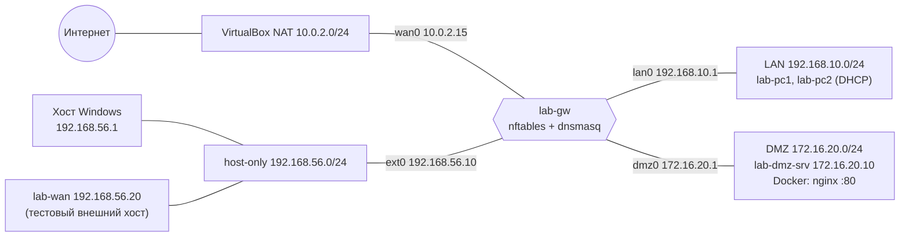

# Отчёт: сеть с DMZ, NAT и firewall в Oracle VirtualBox

## 1. Цель

Построить в VirtualBox сеть из трёх сегментов — внешняя сеть (WAN), локальная сеть (LAN) и
демилитаризованная зона (DMZ), — разделённых маршрутизатором Linux с nftables, и настроить:

* статическую адресацию маршрутизатора и сервера, DHCP для клиентов LAN;
* Source NAT (masquerade) для выхода LAN и DMZ в интернет через внешний адрес шлюза;
* Destination NAT: внешний IP шлюза, порт 80 → веб-сервер nginx в DMZ, порт 80
  (в том числе для клиентов LAN — hairpin);
* политику firewall, присущую DMZ: **любые соединения, инициированные из DMZ в LAN, запрещены**;
  доступность SSH, ICMP, HTTP, DHCP, DNS между зонами — по принципу минимально необходимого;
* nginx в Docker-контейнере на сервере DMZ.

Всё воспроизводимо скриптами (`scripts/up.sh`) и проверяется автоматическим тестом `tests/check.sh`.

## 2. Схема



Соответствие схеме из задания: VM1 «Маршрутизатор» = `lab-gw`; VM2 «Локальная сеть / коммутатор» =
внутренняя сеть VirtualBox `lan` с клиентами `lab-pc1`, `lab-pc2`; VM3 «DMZ» = `lab-dmz-srv`
(контейнер с nginx; «другие сервисы» — SSH для администрирования из LAN). «Host — имитация
пользователя, выход во внешнюю сеть» = хост Windows (host-only) и интернет через NAT-адаптер gw.
Подробно — [topology.md](topology.md).

## 3. Адресный план

| Зона | Сеть | Шлюз | Адресация |
|---|---|---|---|
| WAN: VirtualBox NAT (интернет) | 10.0.2.0/24 | 10.0.2.2 | DHCP VirtualBox, gw `wan0` = 10.0.2.15 |
| WAN: host-only (внешний IP шлюза) | 192.168.56.0/24 | — | gw `ext0` = **192.168.56.10**, хост = .1, lab-wan = .20 |
| LAN | 192.168.10.0/24 | 192.168.10.1 | DHCP с gw, пул .100–.200 |
| DMZ | 172.16.20.0/24 | 172.16.20.1 | статика, dmz-srv = 172.16.20.10 |

LAN и DMZ взяты из разных частных диапазонов RFC 1918 (192.168/16 и 172.16/12), как требует задание.

## 4. Настройка VM

Учётные данные везде `student` / `student`. ОС — Ubuntu 26.04.1 LTS Server (без GUI),
установлена `VBoxManage unattended install` (`scripts/create-vms.sh`, шаблон
`scripts/autoinstall/user-data.tmpl`). Первичная настройка — `scripts/bootstrap-vms.sh`
(hostname, machine-id, SSH host keys, netplan роли, итоговые адаптеры).

### lab-gw — маршрутизатор (1 vCPU / 1 GB)

`scripts/configure-gw.sh`:

* **netplan** [`gateway/netplan.yaml`](../gateway/netplan.yaml): интерфейсы находятся по MAC и
  переименовываются в `wan0` (NAT, DHCP), `ext0` (192.168.56.10/24), `lan0` (192.168.10.1/24),
  `dmz0` (172.16.20.1/24). Маршрут по умолчанию — через `wan0`.
* **sysctl** [`gateway/sysctl.conf`](../gateway/sysctl.conf) → `/etc/sysctl.d/99-lab-gw.conf`:
  `net.ipv4.ip_forward=1` (постоянно), `rp_filter=1` (strict) для `all`, `default` и `*`,
  запрет redirects/source route, `log_martians`, IPv6 выключен.
* **dnsmasq** [`gateway/dnsmasq.conf`](../gateway/dnsmasq.conf) → `/etc/dnsmasq.d/lab.conf`:
  только `lan0`; пул 192.168.10.100–200 /24, аренда 12 ч, опции router и dns-server = 192.168.10.1,
  домен `lab.local`; кеширующий DNS с апстримом от DHCP на `wan0`.
* **nftables** [`gateway/nftables.conf`](../gateway/nftables.conf) → `/etc/nftables.conf`,
  `systemctl enable nftables` (см. раздел 5). `ufw` отключён.

### lab-dmz-srv — сервер DMZ (1 vCPU / 2 GB)

`scripts/configure-dmz.sh`:

* netplan [`dmz/netplan.yaml`](../dmz/netplan.yaml): 172.16.20.10/24, шлюз 172.16.20.1,
  DNS 1.1.1.1 и 8.8.8.8 (сервер DMZ не пользуется сервисами шлюза).
* Docker и `docker compose` (`docker.io`, `docker-compose-v2` из репозитория Ubuntu — ставятся
  через gw по разрешённым DMZ → интернет HTTP/HTTPS).
* [`dmz/docker-compose.yml`](../dmz/docker-compose.yml) → `/opt/dmz-web/`: `nginx:stable-alpine`,
  порт 80:80, `restart: unless-stopped`, страница [`dmz/index.html`](../dmz/index.html) с текстом
  `DMZ web server (dmz-srv)` (том только для чтения).

### lab-pc1, lab-pc2 — клиенты LAN (1 vCPU / 1 GB)

netplan [`lan/netplan.yaml`](../lan/netplan.yaml): DHCP (`dhcp-identifier: mac`). Адрес, маску,
шлюз и DNS получают от gw. `lab-pc2` — linked clone `lab-pc1`.

### lab-wan — тестовый внешний хост (1 vCPU / 1 GB)

host-only, 192.168.56.20/24, маршруты в 192.168.10.0/24 и 172.16.20.0/24 через 192.168.56.10.
Имитирует атакующего в сегменте провайдера: позволяет проверить, что gw фильтрует WAN → LAN/DMZ,
а не просто «нет маршрута». Linked clone `lab-pc1`.

## 5. nftables.conf (полностью, с комментариями)

```nft
#!/usr/sbin/nft -f
# /etc/nftables.conf на lab-gw — NAT и firewall лабы «Сеть с DMZ».
#
# Интерфейсы (имена задаются netplan по MAC, см. gateway/netplan.yaml):
#   wan0  VirtualBox NAT          — реальный выход в интернет («внешняя сеть»)
#   ext0  host-only 192.168.56.10 — внешний IP gw для тестов DNAT с хоста Windows
#   lan0  intnet lan 192.168.10.1/24
#   dmz0  intnet dmz 172.16.20.1/24
# WAN-зона = wan0 + ext0.

# Полностью заменяем текущий набор правил (идемпотентно при `nft -f`).
flush ruleset

define WAN_IFS   = { "wan0", "ext0" }
define LAN_IF    = "lan0"
define DMZ_IF    = "dmz0"
define LAN_NET   = 192.168.10.0/24
define DMZ_NET   = 172.16.20.0/24
define EXT_IP    = 192.168.56.10
define WEB_SRV   = 172.16.20.10
define MGMT_HOST = 192.168.56.1     # хост Windows в host-only сети

table inet filter {

    # ---------------------------------------------------------------- anti-spoofing
    # Раньше conntrack (priority raw): пакет с «чужим» адресом источника для своего
    # интерфейса отбрасывается сразу. Дублирует rp_filter=1 (strict) из sysctl.
    chain antispoof {
        type filter hook prerouting priority raw; policy accept;
        # LAN: только адреса LAN; 0.0.0.0 — DHCPDISCOVER от клиента без адреса
        iifname $LAN_IF ip saddr != { $LAN_NET, 0.0.0.0 } limit rate 10/minute burst 20 packets log prefix "nft-drop: spoof-lan " level warn
        iifname $LAN_IF ip saddr != { $LAN_NET, 0.0.0.0 } drop
        # DMZ: только адреса DMZ
        iifname $DMZ_IF ip saddr != $DMZ_NET limit rate 10/minute burst 20 packets log prefix "nft-drop: spoof-dmz " level warn
        iifname $DMZ_IF ip saddr != $DMZ_NET drop
        # Из WAN не могут прийти внутренние адреса и loopback
        iifname $WAN_IFS ip saddr { $LAN_NET, $DMZ_NET, 127.0.0.0/8 } limit rate 10/minute burst 20 packets log prefix "nft-drop: spoof-wan " level warn
        iifname $WAN_IFS ip saddr { $LAN_NET, $DMZ_NET, 127.0.0.0/8 } drop
    }

    # ---------------------------------------------------------------- трафик К самому gw
    chain input {
        type filter hook input priority filter; policy drop;

        # loopback — всегда
        iif "lo" accept
        # «битые» пакеты, не относящиеся ни к одному известному соединению
        ct state invalid limit rate 10/minute burst 20 packets log prefix "nft-drop: invalid-in " level warn
        ct state invalid drop
        # ответы на соединения, открытые самим gw (apt, DNS-запросы dnsmasq и т.п.)
        ct state established,related accept

        # ICMP echo к gw: глобальный rate limit, превышение — drop
        icmp type echo-request limit rate over 10/second burst 20 packets drop
        # ping gw разрешён из LAN и DMZ (диагностика шлюза), из WAN — нет
        iifname { $LAN_IF, $DMZ_IF } icmp type echo-request accept

        # DHCP (dnsmasq) — только на LAN-интерфейсе
        iifname $LAN_IF udp sport 68 udp dport 67 accept
        # DNS (dnsmasq) для клиентов LAN
        iifname $LAN_IF meta l4proto { tcp, udp } th dport 53 accept
        # SSH на gw из LAN (администрирование)
        iifname $LAN_IF tcp dport 22 accept

        # [LAB-EXCEPTION] Учебное послабление: служебный SSH на gw с хоста Windows
        # через host-only (управление лабой из WSL/Git Bash). В продакшене — убрать
        # и управлять через VPN/bastion из LAN.
        iifname "ext0" ip saddr $MGMT_HOST tcp dport 22 accept comment "LAB-EXCEPTION: management SSH from VirtualBox host"

        # всё остальное — в лог (с лимитом) и в drop по политике цепочки
        limit rate 10/minute burst 20 packets log prefix "nft-drop: in " level warn
    }

    # ---------------------------------------------------------------- транзит ЧЕРЕЗ gw
    chain forward {
        type filter hook forward priority filter; policy drop;

        ct state invalid limit rate 10/minute burst 20 packets log prefix "nft-drop: invalid-fwd " level warn
        ct state invalid drop
        # ответы по уже разрешённым соединениям (в т.ч. DMZ → LAN ответы на запросы из LAN)
        ct state established,related accept

        # ICMP echo транзитом: общий rate limit
        icmp type echo-request limit rate over 20/second burst 50 packets drop

        # DMZ → LAN: любые НОВЫЕ соединения из DMZ в LAN запрещены (явно, с логом)
        iifname $DMZ_IF oifname $LAN_IF limit rate 10/minute burst 20 packets log prefix "nft-drop: dmz->lan " level warn
        iifname $DMZ_IF oifname $LAN_IF drop

        # Опубликованный сервис: только то, что прошло DNAT (внешний IP:80 → dmz-srv:80).
        # Прямой доступ из WAN к 172.16.20.10 без DNAT сюда не попадает.
        ip daddr $WEB_SRV tcp dport 80 ct status dnat accept

        # LAN → DMZ: HTTP, SSH (администрирование), ICMP
        iifname $LAN_IF oifname $DMZ_IF tcp dport { 22, 80 } accept
        iifname $LAN_IF oifname $DMZ_IF icmp type echo-request accept

        # LAN → WAN (интернет и host-only): без ограничений
        iifname $LAN_IF oifname $WAN_IFS accept

        # DMZ → интернет: только то, что нужно серверу — DNS, HTTP, HTTPS (apt, docker pull)
        iifname $DMZ_IF oifname "wan0" meta l4proto { tcp, udp } th dport 53 accept
        iifname $DMZ_IF oifname "wan0" tcp dport { 80, 443 } accept

        # всё остальное (WAN → LAN/DMZ напрямую, DMZ → gw-сети и т.д.) — лог + drop
        limit rate 10/minute burst 20 packets log prefix "nft-drop: fwd " level warn
    }

    # Исходящий трафик самого gw не ограничиваем (apt, DNS-форвардинг dnsmasq).
    chain output {
        type filter hook output priority filter; policy accept;
    }
}

table ip nat {

    chain prerouting {
        type nat hook prerouting priority dstnat; policy accept;
        # DNAT: внешний IP gw :80 → веб-сервер в DMZ.
        # Без привязки к входному интерфейсу — поэтому работает и из LAN/DMZ (hairpin).
        ip daddr $EXT_IP tcp dport 80 dnat to $WEB_SRV:80
    }

    chain postrouting {
        type nat hook postrouting priority srcnat; policy accept;
        # Hairpin внутри DMZ: клиент из DMZ идёт на внешний IP и попадает DNAT-ом
        # в свой же сегмент — подменяем источник на gw, иначе ответ пойдёт мимо gw.
        iifname $DMZ_IF oifname $DMZ_IF ct status dnat masquerade
        # SNAT (masquerade) LAN и DMZ наружу через WAN
        ip saddr { $LAN_NET, $DMZ_NET } oifname $WAN_IFS masquerade
    }
}
```

## 6. Матрица доступа

Обозначения: ✅ разрешено, ❌ запрещено (drop + запись в журнал с префиксом `nft-drop:`),
«ответ» — разрешены только ответы на соединения, открытые с другой стороны (conntrack).

### Транзит через gw (цепочка forward)

| Откуда → куда | SSH | ICMP | HTTP | DHCP | DNS | Прочее |
|---|---|---|---|---|---|---|
| LAN → DMZ | ✅ админ. | ✅ echo | ✅ | — | — | ❌ |
| LAN → WAN/интернет | ✅ | ✅ | ✅ | — | ✅ | ✅ (SNAT) |
| DMZ → LAN | ❌ | ❌ | ❌ | ❌ | ❌ | ❌ (только ответы) |
| DMZ → интернет | ❌ | ❌ | ✅ 80/443 | — | ✅ 53 | ❌ |
| WAN → DMZ | ❌ | ❌ | ✅ только через DNAT 192.168.56.10:80 | — | ❌ | ❌ |
| WAN → LAN | ❌ | ❌ | ❌ | — | ❌ | ❌ |

### К самому gw (цепочка input)

| Откуда → gw | SSH | ICMP | HTTP | DHCP | DNS |
|---|---|---|---|---|---|
| LAN | ✅ | ✅ (rate limit) | — | ✅ udp 67 | ✅ 53 |
| DMZ | ❌ | ✅ (rate limit) | — | ❌ | ❌ |
| WAN (NAT, host-only) | ❌, кроме **LAB-EXCEPTION**: только с 192.168.56.1 | ❌ | ❌ (80 уходит в DNAT) | ❌ | ❌ |

### Обоснование

* **DMZ → LAN запрещено полностью.** DMZ содержит сервисы, доступные из внешней сети, и
  считается наиболее вероятной точкой компрометации. Если взломан веб-сервер, атакующий не
  должен получить ни одного нового соединения в LAN — ни сканирования, ни SSH, ни ping. Ответы
  на соединения, открытые из LAN (например, HTTP-ответ nginx), проходят по `ct state established`.
* **LAN → DMZ: только HTTP, SSH, ICMP.** HTTP — пользоваться сервисом, SSH — администрировать
  сервер из доверенной сети, ICMP echo — диагностика. Остальные порты сервера (например, 443,
  Docker API, метрики) из LAN недоступны.
* **DMZ → интернет: только DNS, HTTP, HTTPS** — ровно то, что нужно серверу для `apt` и `docker pull`.
  Скомпрометированный сервер не сможет открыть SSH/IRC/произвольный TCP наружу (reverse shell на
  нестандартный порт, утечка через ICMP-туннель).
* **DMZ → gw: только ping.** DNS сервер берёт у публичных резолверов, DHCP в DMZ нет (статика),
  SSH на маршрутизатор из DMZ — прямой путь к захвату всей сети.
* **WAN → внутрь: только опубликованный сервис** (DNAT :80). Прямой доступ к 172.16.20.10 с
  WAN-стороны (без DNAT) закрыт правилом `ct status dnat`.
* **DHCP только на LAN**: в DMZ статика, в WAN чужой DHCP-сервер недопустим (rogue DHCP).
  dnsmasq слушает только `lan0`, а input разрешает udp/67 только с `lan0`.
* **SSH на gw**: из LAN — администрирование. С хоста Windows через host-only — **учебное
  послабление** (правило с комментарием `LAB-EXCEPTION`, только с адреса 192.168.56.1), без него
  нельзя управлять лабой из WSL/Git Bash. В продакшене — убрать (см. раздел 11).
* **ICMP** разрешён там, где нужен для диагностики, с ограничением скорости
  (`limit rate over … drop`) против ICMP-флуда. ICMP-ошибки (unreachable, time exceeded) проходят
  как `related` к существующим соединениям.

## 7. SNAT, DNAT, hairpin и conntrack

**Conntrack** (connection tracking) — подсистема ядра, которая для каждого пакета определяет,
к какому соединению он относится, и хранит состояние: `new` (первый пакет), `established`
(соединение уже видело трафик в обе стороны), `related` (связанное: ICMP-ошибка, FTP-data),
`invalid` (не относится ни к чему известному — отбрасывается). Благодаря conntrack firewall
*stateful*: достаточно разрешить **инициирование** соединения в нужную сторону, а правило
`ct state established,related accept` пропустит ответы. Именно так реализовано «DMZ → LAN
запрещено, но ответы на запросы LAN проходят». Conntrack же хранит трансляции NAT: решение
о NAT принимается для первого пакета соединения, остальные транслируются автоматически.

**SNAT / masquerade** (`chain postrouting`, hook `srcnat`). Пакет из LAN (`192.168.10.101 → 8.8.8.8`)
уходит через `wan0`; правило `ip saddr {LAN, DMZ} oifname {wan0, ext0} masquerade` подменяет адрес
источника на адрес выходного интерфейса (10.0.2.15). Ответ приходит на 10.0.2.15, conntrack
находит запись и возвращает исходный адрес назначения 192.168.10.101. `masquerade` вместо `snat to`
— потому что адрес `wan0` динамический (DHCP). Дальше VirtualBox NAT делает ещё одну трансляцию
в адрес хоста — это «провайдерский» NAT.

**DNAT / port forwarding** (`chain prerouting`, hook `dstnat`). Пакет `192.168.56.1 → 192.168.56.10:80`
на входе в gw получает новый адрес назначения `172.16.20.10:80` — до маршрутизации, поэтому
дальше он маршрутизируется в `dmz0` и проходит forward-правило
`ip daddr 172.16.20.10 tcp dport 80 ct status dnat accept`. Ответ nginx идёт на 192.168.56.1
через шлюз по умолчанию 172.16.20.1, conntrack восстанавливает адрес источника 192.168.56.10 —
клиент видит ответ от того адреса, к которому обращался.

**Hairpin (NAT loopback).** Клиент LAN обращается к *внешнему* адресу шлюза, чтобы попасть на
сервис, который физически стоит внутри. Сделано двумя деталями:
1. DNAT-правило не привязано к входному интерфейсу (`ip daddr 192.168.56.10 tcp dport 80`), поэтому
   срабатывает и для пакетов из `lan0`. LAN и DMZ — разные подсети за одним маршрутизатором,
   ответ сервера возвращается через gw, и conntrack делает обратную трансляцию — дополнительный
   SNAT не нужен.
2. Классический hairpin — клиент в **той же** подсети, что и сервер (из DMZ на 192.168.56.10).
   Тогда сервер ответил бы клиенту напрямую, минуя gw, и клиент отбросил бы ответ «не от того»
   адреса. Правило `iifname dmz0 oifname dmz0 ct status dnat masquerade` подменяет источник на
   172.16.20.1, и ответ идёт через gw. Проверяется тестом «dmz-srv → http://192.168.56.10».

## 8. Что такое DMZ и почему DMZ → LAN запрещено

DMZ (demilitarized zone) — отдельный сегмент сети между внешней сетью и внутренней, в котором
размещают сервисы, доступные извне (веб, почта, DNS). Принцип: **внешний мир может обращаться в DMZ,
DMZ не может обращаться во внутреннюю сеть**. Сервер, принимающий соединения из интернета, —
самая атакуемая точка; при его компрометации ущерб ограничен DMZ, потому что firewall не пропустит
новые соединения из DMZ в LAN, где находятся рабочие станции, базы данных, учётные записи.
Внутренние пользователи при этом могут ходить в DMZ (это безопасное направление: соединение
инициирует доверенная сторона), а ответы возвращаются благодаря conntrack. Аналогично ограничен
и выход DMZ в интернет — только то, что нужно для обновлений.

## 9. Вывод tests/check.sh

Запуск: `bash tests/check.sh --reboot-gw` из Git Bash на хосте, 2026-10-29 22:18. Полный вывод (таблица печатается дважды — до и после перезагрузки gw):

```text

=================== прогон 1 ===================
  pc1=192.168.10.189  pc2=192.168.10.138
--- gw: сервисы и ядро
  gw: nftables.service enabled+active                            ожидалось OK    получено OK    PASS
  gw: ruleset загружен (policy drop, лог nft-drop:)   ожидалось OK    получено OK    PASS
  gw: ip_forward=1 (sysctl.d)                                    ожидалось OK    получено OK    PASS
  gw: rp_filter strict на всех интерфейсах      ожидалось OK    получено OK    PASS
  gw: DHCP (dnsmasq) слушает только lan0            ожидалось OK    получено OK    PASS
--- LAN: DHCP, интернет, DNS
  pc1: адрес по DHCP из пула .100-.200              ожидалось OK    получено OK    PASS
  pc1: шлюз и DNS получены по DHCP (192.168.10.1) ожидалось OK    получено OK    PASS
  pc1 -> ping 8.8.8.8 (SNAT)                                     SKIP (сам хост не пингует 8.8.8.8 (ICMP режет VPN/сеть хоста))
  pc1 -> ping 10.0.2.2 (шлюз VirtualBox NAT, ICMP через SNAT) ожидалось OK    получено OK    PASS
  pc1 -> 8.8.8.8 tcp/53 (интернет через SNAT)       ожидалось OK    получено OK    PASS
  pc1 -> DNS: резолв ubuntu.com                            ожидалось OK    получено OK    PASS
  pc1 -> https://ubuntu.com (интернет)                   ожидалось OK    получено OK    PASS
--- LAN -> DMZ / gw
  pc1 -> http://172.16.20.10                                     ожидалось OK    получено OK    PASS
  pc1 -> http://192.168.56.10 (DNAT + hairpin)                   ожидалось OK    получено OK    PASS
  pc1 -> ssh dmz-srv (172.16.20.10:22)                           ожидалось OK    получено OK    PASS
  pc1 -> ping dmz-srv                                            ожидалось OK    получено OK    PASS
  pc1 -> ssh gw (192.168.10.1:22)                                ожидалось OK    получено OK    PASS
  pc1 -> dmz-srv tcp/443 (не разрешён)                 ожидалось DENY  получено DENY  PASS
--- DMZ -> LAN (всё запрещено)
  контроль: pc2 -> pc1 tcp/8080 (внутри LAN)       ожидалось OK    получено OK    PASS
  dmz-srv -> ping pc1                                            ожидалось DENY  получено DENY  PASS
  dmz-srv -> ssh pc1                                             ожидалось DENY  получено DENY  PASS
  dmz-srv -> pc1 tcp/8080 (слушатель запущен)    ожидалось DENY  получено DENY  PASS
  dmz-srv -> pc1 tcp/80,443,3389,445                             ожидалось DENY  получено DENY  PASS
  dmz-srv -> ssh gw (172.16.20.1:22)                             ожидалось DENY  получено DENY  PASS
  gw: в журнале есть nft-drop: dmz->lan              ожидалось OK    получено OK    PASS
--- DMZ -> интернет (только DNS/HTTP/HTTPS)
  dmz-srv -> DNS: резолв archive.ubuntu.com                ожидалось OK    получено OK    PASS
  dmz-srv -> apt-get update (HTTP/HTTPS)                         ожидалось OK    получено OK    PASS
  dmz-srv -> https://registry-1.docker.io                        ожидалось OK    получено OK    PASS
  dmz-srv -> github.com:22 (не разрешён)               ожидалось DENY  получено DENY  PASS
  dmz-srv -> ping 8.8.8.8 (не разрешён)                ожидалось DENY  получено DENY  PASS
  dmz-srv -> http://192.168.56.10 (hairpin в DMZ)               ожидалось OK    получено OK    PASS
  dmz-srv: контейнер nginx unless-stopped, Up           ожидалось OK    получено OK    PASS
--- WAN (хост Windows и lab-wan) -> внутрь
  host -> http://192.168.56.10 (DNAT)                            ожидалось OK    получено OK    PASS
  host -> ssh gw 192.168.56.10 [LAB-EXCEPTION]                   ожидалось OK    получено OK    PASS
  host -> ssh dmz-srv 172.16.20.10 (WAN -> DMZ)                  ожидалось DENY  получено DENY  PASS
  wan -> http://192.168.56.10 (DNAT)                             ожидалось OK    получено OK    PASS
  wan -> ssh dmz-srv 172.16.20.10 (маршрут через gw) ожидалось DENY  получено DENY  PASS
  wan -> http://172.16.20.10 напрямую, без DNAT       ожидалось DENY  получено DENY  PASS
  wan -> ssh pc1                                                 ожидалось DENY  получено DENY  PASS
  wan -> ping pc1                                                ожидалось DENY  получено DENY  PASS
  wan -> ssh gw (послабление только для 192.168.56.1) ожидалось DENY  получено DENY  PASS
  wan -> ping gw                                                 ожидалось DENY  получено DENY  PASS
  wan -> DNS на gw 192.168.56.10:53                            ожидалось DENY  получено DENY  PASS

| # | Проверка | Ожидалось | Получено | Итог |
|---|---|---|---|---|
| 1 | gw: nftables.service enabled+active | OK | OK | PASS |
| 2 | gw: ruleset загружен (policy drop, лог nft-drop:) | OK | OK | PASS |
| 3 | gw: ip_forward=1 (sysctl.d) | OK | OK | PASS |
| 4 | gw: rp_filter strict на всех интерфейсах | OK | OK | PASS |
| 5 | gw: DHCP (dnsmasq) слушает только lan0 | OK | OK | PASS |
| 6 | pc1: адрес по DHCP из пула .100-.200 | OK | OK | PASS |
| 7 | pc1: шлюз и DNS получены по DHCP (192.168.10.1) | OK | OK | PASS |
| 8 | pc1 -> ping 8.8.8.8 (SNAT) | OK | — | SKIP: сам хост не пингует 8.8.8.8 (ICMP режет VPN/сеть хоста) |
| 9 | pc1 -> ping 10.0.2.2 (шлюз VirtualBox NAT, ICMP через SNAT) | OK | OK | PASS |
| 10 | pc1 -> 8.8.8.8 tcp/53 (интернет через SNAT) | OK | OK | PASS |
| 11 | pc1 -> DNS: резолв ubuntu.com | OK | OK | PASS |
| 12 | pc1 -> https://ubuntu.com (интернет) | OK | OK | PASS |
| 13 | pc1 -> http://172.16.20.10 | OK | OK | PASS |
| 14 | pc1 -> http://192.168.56.10 (DNAT + hairpin) | OK | OK | PASS |
| 15 | pc1 -> ssh dmz-srv (172.16.20.10:22) | OK | OK | PASS |
| 16 | pc1 -> ping dmz-srv | OK | OK | PASS |
| 17 | pc1 -> ssh gw (192.168.10.1:22) | OK | OK | PASS |
| 18 | pc1 -> dmz-srv tcp/443 (не разрешён) | DENY | DENY | PASS |
| 19 | контроль: pc2 -> pc1 tcp/8080 (внутри LAN) | OK | OK | PASS |
| 20 | dmz-srv -> ping pc1 | DENY | DENY | PASS |
| 21 | dmz-srv -> ssh pc1 | DENY | DENY | PASS |
| 22 | dmz-srv -> pc1 tcp/8080 (слушатель запущен) | DENY | DENY | PASS |
| 23 | dmz-srv -> pc1 tcp/80,443,3389,445 | DENY | DENY | PASS |
| 24 | dmz-srv -> ssh gw (172.16.20.1:22) | DENY | DENY | PASS |
| 25 | gw: в журнале есть nft-drop: dmz->lan | OK | OK | PASS |
| 26 | dmz-srv -> DNS: резолв archive.ubuntu.com | OK | OK | PASS |
| 27 | dmz-srv -> apt-get update (HTTP/HTTPS) | OK | OK | PASS |
| 28 | dmz-srv -> https://registry-1.docker.io | OK | OK | PASS |
| 29 | dmz-srv -> github.com:22 (не разрешён) | DENY | DENY | PASS |
| 30 | dmz-srv -> ping 8.8.8.8 (не разрешён) | DENY | DENY | PASS |
| 31 | dmz-srv -> http://192.168.56.10 (hairpin в DMZ) | OK | OK | PASS |
| 32 | dmz-srv: контейнер nginx unless-stopped, Up | OK | OK | PASS |
| 33 | host -> http://192.168.56.10 (DNAT) | OK | OK | PASS |
| 34 | host -> ssh gw 192.168.56.10 [LAB-EXCEPTION] | OK | OK | PASS |
| 35 | host -> ssh dmz-srv 172.16.20.10 (WAN -> DMZ) | DENY | DENY | PASS |
| 36 | wan -> http://192.168.56.10 (DNAT) | OK | OK | PASS |
| 37 | wan -> ssh dmz-srv 172.16.20.10 (маршрут через gw) | DENY | DENY | PASS |
| 38 | wan -> http://172.16.20.10 напрямую, без DNAT | DENY | DENY | PASS |
| 39 | wan -> ssh pc1 | DENY | DENY | PASS |
| 40 | wan -> ping pc1 | DENY | DENY | PASS |
| 41 | wan -> ssh gw (послабление только для 192.168.56.1) | DENY | DENY | PASS |
| 42 | wan -> ping gw | DENY | DENY | PASS |
| 43 | wan -> DNS на gw 192.168.56.10:53 | DENY | DENY | PASS |

ИТОГ (прогон 1): PASS=42 FAIL=0

[22:13:00] Перезагружаю gw и жду SSH
[22:14:52] gw снова доступен: up 1 minute

=================== после перезагрузки gw ===================
  pc1=192.168.10.189  pc2=192.168.10.138
--- gw: сервисы и ядро
  gw: nftables.service enabled+active                            ожидалось OK    получено OK    PASS
  gw: ruleset загружен (policy drop, лог nft-drop:)   ожидалось OK    получено OK    PASS
  gw: ip_forward=1 (sysctl.d)                                    ожидалось OK    получено OK    PASS
  gw: rp_filter strict на всех интерфейсах      ожидалось OK    получено OK    PASS
  gw: DHCP (dnsmasq) слушает только lan0            ожидалось OK    получено OK    PASS
--- LAN: DHCP, интернет, DNS
  pc1: адрес по DHCP из пула .100-.200              ожидалось OK    получено OK    PASS
  pc1: шлюз и DNS получены по DHCP (192.168.10.1) ожидалось OK    получено OK    PASS
  pc1 -> ping 8.8.8.8 (SNAT)                                     SKIP (сам хост не пингует 8.8.8.8 (ICMP режет VPN/сеть хоста))
  pc1 -> ping 10.0.2.2 (шлюз VirtualBox NAT, ICMP через SNAT) ожидалось OK    получено OK    PASS
  pc1 -> 8.8.8.8 tcp/53 (интернет через SNAT)       ожидалось OK    получено OK    PASS
  pc1 -> DNS: резолв ubuntu.com                            ожидалось OK    получено OK    PASS
  pc1 -> https://ubuntu.com (интернет)                   ожидалось OK    получено OK    PASS
--- LAN -> DMZ / gw
  pc1 -> http://172.16.20.10                                     ожидалось OK    получено OK    PASS
  pc1 -> http://192.168.56.10 (DNAT + hairpin)                   ожидалось OK    получено OK    PASS
  pc1 -> ssh dmz-srv (172.16.20.10:22)                           ожидалось OK    получено OK    PASS
  pc1 -> ping dmz-srv                                            ожидалось OK    получено OK    PASS
  pc1 -> ssh gw (192.168.10.1:22)                                ожидалось OK    получено OK    PASS
  pc1 -> dmz-srv tcp/443 (не разрешён)                 ожидалось DENY  получено DENY  PASS
--- DMZ -> LAN (всё запрещено)
  контроль: pc2 -> pc1 tcp/8080 (внутри LAN)       ожидалось OK    получено OK    PASS
  dmz-srv -> ping pc1                                            ожидалось DENY  получено DENY  PASS
  dmz-srv -> ssh pc1                                             ожидалось DENY  получено DENY  PASS
  dmz-srv -> pc1 tcp/8080 (слушатель запущен)    ожидалось DENY  получено DENY  PASS
  dmz-srv -> pc1 tcp/80,443,3389,445                             ожидалось DENY  получено DENY  PASS
  dmz-srv -> ssh gw (172.16.20.1:22)                             ожидалось DENY  получено DENY  PASS
  gw: в журнале есть nft-drop: dmz->lan              ожидалось OK    получено OK    PASS
--- DMZ -> интернет (только DNS/HTTP/HTTPS)
  dmz-srv -> DNS: резолв archive.ubuntu.com                ожидалось OK    получено OK    PASS
  dmz-srv -> apt-get update (HTTP/HTTPS)                         ожидалось OK    получено OK    PASS
  dmz-srv -> https://registry-1.docker.io                        ожидалось OK    получено OK    PASS
  dmz-srv -> github.com:22 (не разрешён)               ожидалось DENY  получено DENY  PASS
  dmz-srv -> ping 8.8.8.8 (не разрешён)                ожидалось DENY  получено DENY  PASS
  dmz-srv -> http://192.168.56.10 (hairpin в DMZ)               ожидалось OK    получено OK    PASS
  dmz-srv: контейнер nginx unless-stopped, Up           ожидалось OK    получено OK    PASS
--- WAN (хост Windows и lab-wan) -> внутрь
  host -> http://192.168.56.10 (DNAT)                            ожидалось OK    получено OK    PASS
  host -> ssh gw 192.168.56.10 [LAB-EXCEPTION]                   ожидалось OK    получено OK    PASS
  host -> ssh dmz-srv 172.16.20.10 (WAN -> DMZ)                  ожидалось DENY  получено DENY  PASS
  wan -> http://192.168.56.10 (DNAT)                             ожидалось OK    получено OK    PASS
  wan -> ssh dmz-srv 172.16.20.10 (маршрут через gw) ожидалось DENY  получено DENY  PASS
  wan -> http://172.16.20.10 напрямую, без DNAT       ожидалось DENY  получено DENY  PASS
  wan -> ssh pc1                                                 ожидалось DENY  получено DENY  PASS
  wan -> ping pc1                                                ожидалось DENY  получено DENY  PASS
  wan -> ssh gw (послабление только для 192.168.56.1) ожидалось DENY  получено DENY  PASS
  wan -> ping gw                                                 ожидалось DENY  получено DENY  PASS
  wan -> DNS на gw 192.168.56.10:53                            ожидалось DENY  получено DENY  PASS

| # | Проверка | Ожидалось | Получено | Итог |
|---|---|---|---|---|
| 1 | gw: nftables.service enabled+active | OK | OK | PASS |
| 2 | gw: ruleset загружен (policy drop, лог nft-drop:) | OK | OK | PASS |
| 3 | gw: ip_forward=1 (sysctl.d) | OK | OK | PASS |
| 4 | gw: rp_filter strict на всех интерфейсах | OK | OK | PASS |
| 5 | gw: DHCP (dnsmasq) слушает только lan0 | OK | OK | PASS |
| 6 | pc1: адрес по DHCP из пула .100-.200 | OK | OK | PASS |
| 7 | pc1: шлюз и DNS получены по DHCP (192.168.10.1) | OK | OK | PASS |
| 8 | pc1 -> ping 8.8.8.8 (SNAT) | OK | — | SKIP: сам хост не пингует 8.8.8.8 (ICMP режет VPN/сеть хоста) |
| 9 | pc1 -> ping 10.0.2.2 (шлюз VirtualBox NAT, ICMP через SNAT) | OK | OK | PASS |
| 10 | pc1 -> 8.8.8.8 tcp/53 (интернет через SNAT) | OK | OK | PASS |
| 11 | pc1 -> DNS: резолв ubuntu.com | OK | OK | PASS |
| 12 | pc1 -> https://ubuntu.com (интернет) | OK | OK | PASS |
| 13 | pc1 -> http://172.16.20.10 | OK | OK | PASS |
| 14 | pc1 -> http://192.168.56.10 (DNAT + hairpin) | OK | OK | PASS |
| 15 | pc1 -> ssh dmz-srv (172.16.20.10:22) | OK | OK | PASS |
| 16 | pc1 -> ping dmz-srv | OK | OK | PASS |
| 17 | pc1 -> ssh gw (192.168.10.1:22) | OK | OK | PASS |
| 18 | pc1 -> dmz-srv tcp/443 (не разрешён) | DENY | DENY | PASS |
| 19 | контроль: pc2 -> pc1 tcp/8080 (внутри LAN) | OK | OK | PASS |
| 20 | dmz-srv -> ping pc1 | DENY | DENY | PASS |
| 21 | dmz-srv -> ssh pc1 | DENY | DENY | PASS |
| 22 | dmz-srv -> pc1 tcp/8080 (слушатель запущен) | DENY | DENY | PASS |
| 23 | dmz-srv -> pc1 tcp/80,443,3389,445 | DENY | DENY | PASS |
| 24 | dmz-srv -> ssh gw (172.16.20.1:22) | DENY | DENY | PASS |
| 25 | gw: в журнале есть nft-drop: dmz->lan | OK | OK | PASS |
| 26 | dmz-srv -> DNS: резолв archive.ubuntu.com | OK | OK | PASS |
| 27 | dmz-srv -> apt-get update (HTTP/HTTPS) | OK | OK | PASS |
| 28 | dmz-srv -> https://registry-1.docker.io | OK | OK | PASS |
| 29 | dmz-srv -> github.com:22 (не разрешён) | DENY | DENY | PASS |
| 30 | dmz-srv -> ping 8.8.8.8 (не разрешён) | DENY | DENY | PASS |
| 31 | dmz-srv -> http://192.168.56.10 (hairpin в DMZ) | OK | OK | PASS |
| 32 | dmz-srv: контейнер nginx unless-stopped, Up | OK | OK | PASS |
| 33 | host -> http://192.168.56.10 (DNAT) | OK | OK | PASS |
| 34 | host -> ssh gw 192.168.56.10 [LAB-EXCEPTION] | OK | OK | PASS |
| 35 | host -> ssh dmz-srv 172.16.20.10 (WAN -> DMZ) | DENY | DENY | PASS |
| 36 | wan -> http://192.168.56.10 (DNAT) | OK | OK | PASS |
| 37 | wan -> ssh dmz-srv 172.16.20.10 (маршрут через gw) | DENY | DENY | PASS |
| 38 | wan -> http://172.16.20.10 напрямую, без DNAT | DENY | DENY | PASS |
| 39 | wan -> ssh pc1 | DENY | DENY | PASS |
| 40 | wan -> ping pc1 | DENY | DENY | PASS |
| 41 | wan -> ssh gw (послабление только для 192.168.56.1) | DENY | DENY | PASS |
| 42 | wan -> ping gw | DENY | DENY | PASS |
| 43 | wan -> DNS на gw 192.168.56.10:53 | DENY | DENY | PASS |

ИТОГ (после перезагрузки gw): PASS=42 FAIL=0
ВСЕ ПРОВЕРКИ ЗЕЛЁНЫЕ
```

### Прогон с выключенным VPN на хосте

На хосте работает VPN, который режет ICMP в интернет (см. раздел 10, п. 7), поэтому в основном прогоне
выше `pc1 -> ping 8.8.8.8` помечен SKIP. Отдельный прогон `bash tests/check.sh` с **выключенным VPN**
(2026-10-29 23:21): **43 PASS, 0 FAIL**, в том числе `pc1 -> ping 8.8.8.8 (SNAT) — PASS`.
Полный вывод — [check-output-novpn.txt](check-output-novpn.txt).

```text
  pc1 -> ping 8.8.8.8 (SNAT)                         ожидалось OK    получено OK    PASS
  pc1 -> ping 10.0.2.2 (шлюз VirtualBox NAT)         ожидалось OK    получено OK    PASS
  pc1 -> 8.8.8.8 tcp/53 (интернет через SNAT)        ожидалось OK    получено OK    PASS
...
ИТОГ (прогон 1): PASS=43 FAIL=0
ВСЕ ПРОВЕРКИ ЗЕЛЁНЫЕ
```


## 10. Возникшие проблемы и решения

| # | Проблема | Причина | Решение |
|---|---|---|---|
| 1 | Desktop ISO: `unattended install` не стартует, гость зависает | Десктопный установщик требует графическую сессию; VirtualBox работает поверх Hyper-V (NEM, т.к. включены WSL2/Docker) — live-сессия зависла на инициализации snap | Перешли на **Ubuntu 26.04.1 Live Server ISO** (текстовый subiquity); Hyper-V не отключали, чтобы не трогать настройки Windows ([decisions §3–4](decisions.md)) |
| 2 | Промежуточная попытка с debootstrap «повисла» на скачивании | `wget` без таймаутов + подвисшее TCP-соединение через NAT под NEM | Отказались от самодельного установщика в пользу штатного autoinstall |
| 3 | Первая версия шаблона не принята VirtualBox (`Malformed template placeholder`) | В комментарии шаблона был текст вида `@@VBOX_...@@` | Комментарий переписан без `@@` |
| 4 | `wait_ssh` / `wait_poweroff` сообщали об ошибке при успехе | Цикл `until` в bash возвращает статус последней команды тела (`[ $t -ge … ] && …` → 1) | Явный `return 0` после цикла + пауза 3 с после выключения VM (VBoxSVC отпускает блокировку не мгновенно) |
| 5 | В LAN и DMZ нет доступа с хоста, Guest Additions не ставились | Изоляция intnet | Первичная настройка через **временный port forward на NAT** 127.0.0.1:22xx → 22, затем итоговые адаптеры; дальше — `ProxyJump gw` ([decisions §6](decisions.md)) |
| 6 | `rp_filter=1` в `all` не включает strict-режим | systemd ставит `net.ipv4.conf.*.rp_filter=2`, а ядро берёт `max(all, iface)` | В sysctl добавлена маска `net.ipv4.conf.*.rp_filter = 1`; тест проверяет значение на каждом интерфейсе |
| 7 | `ping 8.8.8.8` из LAN не проходит | На хосте VPN (`happ-default-tun`), ICMP в интернет не проходит **даже с Windows**; VirtualBox NAT пингует от имени хоста | Проверка помечается SKIP, если хост сам не пингует; SNAT для ICMP проверяется пингом `10.0.2.2`, выход в интернет — TCP 8.8.8.8:53 и HTTPS. С выключенным VPN проверено: ping 8.8.8.8 из LAN — PASS (раздел 9) ([decisions §2a](decisions.md)) |
| 8 | Тест «хост → 172.16.20.10:22» давал ложный OK | TUN-интерфейс VPN сам принимает любые TCP-соединения (маршрут 128.0.0.0/1) | Проверка по SSH-баннеру; честная проверка WAN → DMZ — с отдельной VM `lab-wan`, у которой маршрут в DMZ идёт через gw |
| 9 | Проверка «WAN → ssh dmz-srv» с хоста ничего не доказывает про firewall | У Windows нет маршрута в 172.16.20.0/24 | Добавлен тестовый внешний хост `lab-wan` (linked clone pc1) с маршрутами в LAN/DMZ через gw |
| 10 | dnsmasq мог конфликтовать с systemd-resolved на :53 | resolved слушает 127.0.0.53 | `interface=lan0` + `bind-dynamic` — dnsmasq слушает только 192.168.10.1 |

## 11. Что поменять для продакшена

* **Убрать LAB-EXCEPTION** (SSH на gw из WAN). Администрирование — из выделенной management-сети
  или через VPN (WireGuard) / bastion, SSH только по ключам (`PasswordAuthentication no`,
  `PermitRootLogin no`), fail2ban/`ct count` против перебора.
* **Убрать учебные учётные данные** и `NOPASSWD` sudo; персональные учётки, ключи, MFA для админов.
* **Политика output** на gw тоже `drop` с явным списком (DNS, NTP, apt), чтобы скомпрометированный
  шлюз не мог свободно ходить наружу.
* **HTTPS** на опубликованном сервисе (443 с сертификатом Let's Encrypt), HSTS; DNAT для 443 вместо/вместе с 80
  (80 — только редирект).
* **Egress DMZ** — не «любой 80/443», а через прокси/зеркало (apt-cacher-ng, приватный registry);
  NTP для сервера DMZ (сейчас не разрешён — время синхронизируется только при загрузке VM).
* **Docker на сервере DMZ**: пиннинг образа по digest, read-only rootfs, `no-new-privileges`,
  ограничения ресурсов, непривилегированный пользователь в контейнере, регулярные обновления.
* **Логи**: отправлять `nft-drop:` и журналы в центральный syslog/SIEM, алерты на попытки DMZ → LAN.
* **IPv6**: либо явно выключить на всём периметре, либо полноценная политика ip6 (сейчас drop по умолчанию).
* **Отказоустойчивость**: второй маршрутизатор (keepalived/VRRP + conntrackd), бэкап конфигов,
  конфигурация через Ansible/IaC вместо bash-скриптов.
* **DHCP**: статические резервации для серверов LAN, DHCP snooping на коммутаторах,
  разделение LAN на VLAN (пользователи, админы, принтеры).
* **IDS/IPS** (Suricata) на периметре и между DMZ и LAN; защита от SYN-флуда (synproxy в nftables).
