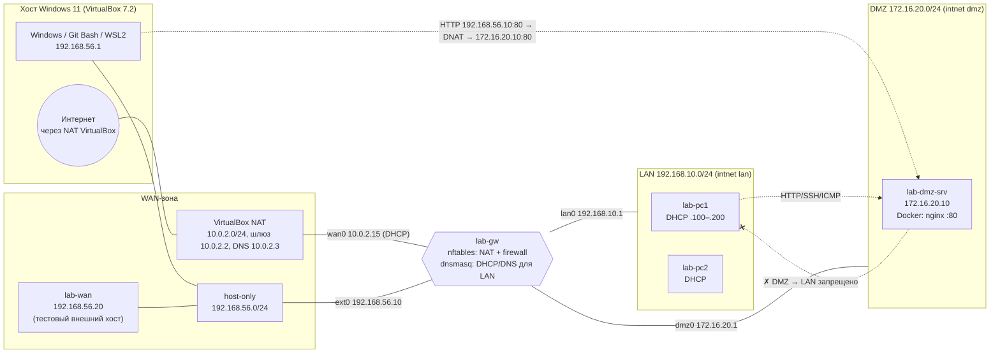

# Топология лабы

## Схема

## Адресный план

| Сеть | Назначение | Адрес/маска | Шлюз | Кто адресует |
|---|---|---|---|---|
| VirtualBox NAT | реальный выход в интернет («внешняя сеть») | 10.0.2.0/24 | 10.0.2.2 | DHCP VirtualBox → gw `wan0` = 10.0.2.15 |
| host-only `VirtualBox Host-Only Ethernet Adapter` | «внешний» сегмент для тестов DNAT | 192.168.56.0/24 | — | статика |
| LAN (intnet `lan`) | клиенты | 192.168.10.0/24 | 192.168.10.1 | DHCP gw, пул .100–.200, аренда 12 ч |
| DMZ (intnet `dmz`) | публичные серверы | 172.16.20.0/24 | 172.16.20.1 | статика |

| Хост | Интерфейс | Адрес |
|---|---|---|
| Windows | host-only | 192.168.56.1 |
| lab-gw | wan0 / ext0 / lan0 / dmz0 | DHCP (10.0.2.15) / 192.168.56.10 / 192.168.10.1 / 172.16.20.1 |
| lab-dmz-srv | enp0s3 | 172.16.20.10/24, gw .1, DNS 1.1.1.1, 8.8.8.8 |
| lab-pc1, lab-pc2 | enp0s3 | DHCP из 192.168.10.100–200, gw .1, DNS 192.168.10.1 |
| lab-wan | enp0s3 | 192.168.56.20/24, маршруты 192.168.10.0/24 и 172.16.20.0/24 via 192.168.56.10 |

## Адаптеры VirtualBox

| VM | CPU/RAM | nic1 | nic2 | nic3 | nic4 |
|---|---|---|---|---|---|
| lab-gw | 1 / 1 GB | NAT, `08:00:27:AA:01:01` → `wan0` | host-only, `…:01:02` → `ext0` | intnet `lan`, `…:01:03` → `lan0` | intnet `dmz`, `…:01:04` → `dmz0` |
| lab-dmz-srv | 1 / 2 GB | intnet `dmz`, `08:00:27:AA:02:01` | — | — | — |
| lab-pc1 | 1 / 1 GB | intnet `lan`, `08:00:27:AA:03:01` | — | — | — |
| lab-pc2 | 1 / 1 GB | intnet `lan`, `08:00:27:AA:04:01` | — | — | — |
| lab-wan | 1 / 1 GB | host-only, `08:00:27:AA:06:01` | — | — | — |

Все адаптеры — Intel PRO/1000 MT Desktop (82540EM). `lab-gw`, `lab-dmz-srv`, `lab-pc1` — отдельные VM
с диском 15 GB (VDI, dynamic), Ubuntu 26.04.1 Server установлен `VBoxManage unattended install`.
`lab-pc2` и `lab-wan` — linked clones от снапшота `lab-pc1/clean` (дифференциальные диски).

## Временный доступ при первичной настройке

| VM | port forward на NAT (только на время bootstrap) |
|---|---|
| lab-gw | 127.0.0.1:2210 → 22 |
| lab-dmz-srv | 127.0.0.1:2220 → 22 |
| lab-pc1 / lab-pc2 | 127.0.0.1:2231 / 2232 → 22 |
| lab-wan | 127.0.0.1:2240 → 22 |

После bootstrap правила удаляются, и доступ идёт так: хост → `192.168.56.10` (gw) напрямую,
к dmz-srv и pc* — `ProxyJump gw`, к lab-wan — напрямую `192.168.56.20`.
